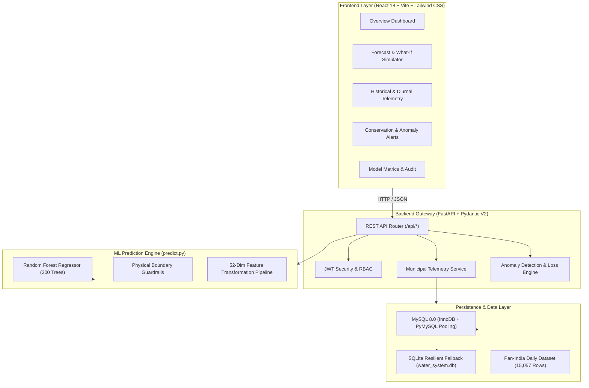

# AquaPulse: Intelligent Water Consumption Forecasting & Conservation Analytics Platform

[](https://www.python.org/)
[](https://fastapi.tiangolo.com/)
[](https://react.dev/)
[](https://scikit-learn.org/)
[](https://www.mysql.com/)
[](https://www.docker.com/)
[-brightgreen.svg)]()

AquaPulse is an enterprise-grade predictive water analytics platform combining machine learning forecasting, real-time telemetry, automated anomaly detection, and data-grounded conservation roadmaps across **21 Indian metropolitan water boards** and municipal water grids.

---

## Architecture Overview



---

## Key Features

1. **Machine Learning Predictive Engine:**
   * **Champion Algorithm:** Random Forest Regressor (200 trees, max depth 16).
   * **Holdout Test Accuracy:** $R^2 = 99.83\%$, $\text{MAE} = 20.788\text{ MLD}$, $\text{RMSE} = 40.471\text{ MLD}$, $\text{MAPE} = 2.00\%$.
   * **Forecasting Modes:** Single-day point prediction, recursive 7–30 day horizon, and calendar month volumetric budgets (MLD, MCM, and Billion Litres) with 95% confidence intervals.
2. **Water Conservation & Anomaly Detection:**
   * Grounded detection of non-revenue water (NRW) losses $> 30\%$, statistical demand surges ($Z > 2.2$), and rain-decoupling horticultural draw.
   * Dynamic payback simulator estimating volumetric water recovery and financial cost savings.
3. **Database Dual-Dialect Resilience:**
   * Full MySQL 8.0 support with connection pooling, transaction rollbacks, and InnoDB foreign key constraints.
   * Graceful zero-configuration SQLite fallback when MySQL is unconfigured.
4. **Security & Physical Boundary Validation:**
   * Strict validation rejecting inverted temperatures ($T_{\text{min}} > T_{\text{max}}$), negative rainfall, and uncalibrated cities.
   * Parameterized queries blocking SQL injection attempts and sanitizing XSS inputs.

---

## Quick Start (Local Development)

### Prerequisites
* Python 3.11+ (Python 3.14 compatible)
* Node.js 18+ (Node 20 recommended)

### 1. Launch Backend API
```powershell
# From project root:
run-backend.bat
```
*API Swagger Documentation will be available at:* `http://localhost:8000/docs`

### 2. Launch Frontend Dev Server
```powershell
# In a separate terminal:
run-frontend.bat
```
*React Dashboard will be available at:* `http://localhost:5173`

---

## Production Deployment Guide

AquaPulse is packaged for single-command production deployment on Docker, Render, and AWS.

### Option 1: Docker Compose (Local or Virtual Machine)
Runs MySQL 8.0 along with the compiled multi-stage AquaPulse application container:
```bash
# Build and start all services
docker compose up --build -d

# Check running status
docker compose ps

# View application logs
docker compose logs -f aquapulse_app
```
Access the application at `http://localhost:8000`.

---

### Option 2: Render Cloud Deployment (Single-Click Blueprint)

1. Fork or push this repository to GitHub/GitLab.
2. Sign in to your [Render Dashboard](https://dashboard.render.com/).
3. Click **New +** $\rightarrow$ **Blueprint**.
4. Select your repository. Render automatically reads [`render.yaml`](file:///c:/Users/ASUS/Downloads/water-forecast-system/render.yaml) and configures:
   * **Runtime:** Docker (`Dockerfile`)
   * **Health Check Path:** `/api/health`
   * **Auto HTTPS & SSL:** Enabled
5. Click **Apply**. Within 3–5 minutes, your service will be live at `https://<your-app-name>.onrender.com`.

---

### Option 3: AWS Deployment (App Runner / ECS Fargate / Lightsail)

#### Using AWS App Runner (Fastest & Fully Managed):
1. Create an ECR (Elastic Container Registry) repository:
   ```bash
   aws ecr create-repository --repository-name aquapulse-app
   ```
2. Build and push the Docker image:
   ```bash
   docker build -t aquapulse-app .
   aws ecr get-login-password --region us-east-1 | docker login --username AWS --password-stdin <aws_account_id>.dkr.ecr.us-east-1.amazonaws.com
   docker tag aquapulse-app:latest <aws_account_id>.dkr.ecr.us-east-1.amazonaws.com/aquapulse-app:latest
   docker push <aws_account_id>.dkr.ecr.us-east-1.amazonaws.com/aquapulse-app:latest
   ```
3. In AWS App Runner console:
   * **Source:** Container registry $\rightarrow$ Select your ECR image.
   * **Port:** `8000`
   * **Health check URL:** `/api/health`
   * **Environment Variables:** Set `ENVIRONMENT=production`, `DB_ENGINE=mysql`, `DATABASE_URL` (AWS RDS MySQL endpoint), and `SECRET_KEY`.
4. Click **Deploy**.

---

## Environment Variables Reference

| Variable | Default Value | Description |
| :--- | :--- | :--- |
| `ENVIRONMENT` | `production` | Deployment mode (`development` or `production`) |
| `HOST` | `0.0.0.0` | Host IP for uvicorn to bind |
| `PORT` | `8000` | Port for backend service |
| `DB_ENGINE` | `sqlite` | Database engine (`sqlite` or `mysql`) |
| `DATABASE_URL` | `sqlite:///./water_system.db` | SQLAlchemy connection string |
| `MYSQL_HOST` | `localhost` | MySQL server host (when `DB_ENGINE=mysql`) |
| `MYSQL_PORT` | `3306` | MySQL port |
| `MYSQL_USER` | `root` | MySQL username |
| `MYSQL_PASSWORD`| `""` | MySQL password |
| `MYSQL_DATABASE`| `aquapulse_water_db`| MySQL database name |
| `SECRET_KEY` | *(Set a random string)* | JWT HMAC secret key |
| `CORS_ORIGINS` | `http://localhost:5173,...` | Comma-separated list of allowed web origins |
| `LOG_LEVEL` | `INFO` | Logger verbosity (`DEBUG`, `INFO`, `WARNING`, `ERROR`) |

---

## Automated Test Suite

AquaPulse includes 65 automated tests covering model accuracy, API contracts, MySQL CRUD, and security attacks.

Run all tests:
```powershell
# 1. Prediction Engine Verification
python test_predict.py

# 2. Complete Backend & Security Audit
python -m pytest -o pythonpath=backend backend/tests/ -v
```

---

## Project Directory Layout (Modular Architecture)

AquaPulse is organized into cleanly separated, independent modules:

```
water-forecast-system/
├── Dockerfile                      # Multi-stage production container build
├── docker-compose.yml              # Local MySQL 8.0 + app stack
├── render.yaml                     # Render Infrastructure-as-Code blueprint
├── .env.example                    # Environment variable template
├── .gitattributes                  # Git LFS tracking for model binaries
├── .gitignore                      # Production git exclusions
├── predict.py                      # Root ML inference entrypoint bridge
├── test_predict.py                 # Standalone prediction test harness
├── run.bat                         # Unified one-click platform launcher
│
├── frontend/                       # 🌐 Modern Web Frontend (React + TypeScript + Vite)
│   ├── public/                     # Static assets, icons, and conservation photography
│   ├── src/
│   │   ├── components/             # Reusable UI widgets (Navbar, Alerts, SimulatorModal)
│   │   ├── services/api.ts         # Axios API client connecting to FastAPI backend
│   │   ├── types/                  # Strict TypeScript contracts for data payloads
│   │   ├── views/                  # 7 specialized platform views (Landing, Forecast, etc.)
│   │   ├── App.tsx                 # Root application router and layout shell
│   │   └── index.css               # Tailwind & custom light theme styles
│   ├── package.json                # Dependencies (React, Recharts, Lucide, Tailwind CSS)
│   └── README.md                   # Frontend architecture & setup guide
│
├── backend/                        # ⚙️ FastAPI Backend & Analytics Server
│   ├── run.py                      # Backend server runner (uvicorn)
│   ├── requirements.txt            # Python dependencies (fastapi, scikit-learn, pymysql)
│   ├── app/
│   │   ├── auth/                   # JWT authentication & role-based access control
│   │   ├── crud/                   # Database CRUD operations
│   │   ├── models/                 # SQLAlchemy ORM schemas
│   │   ├── routers/                # API endpoints (forecast, conservation, weather, admin)
│   │   ├── schemas/                # Pydantic request/response validation schemas
│   │   ├── services/               # WaterMLService & ConservationAnalyticsService
│   │   ├── config.py               # Application settings
│   │   ├── database.py             # Dual-engine connection pool & SQLite fallback
│   │   └── main.py                 # FastAPI application entrypoint
│   ├── database/                   # Migrations & database seeding routines
│   ├── tests/                      # Automated pytest suite (58 tests)
│   └── README.md                   # Backend architecture & API documentation
│
├── ml_pipeline/                    # 🧠 Machine Learning Engine & Audit Pipeline
│   ├── models/                     # Serialized production bundles (*.pkl) & metrics
│   │   ├── best_water_consumption_model.pkl   # Production ensemble (72.9 MB)
│   │   └── evaluation_metrics.json            # Model benchmark scores
│   ├── audit_reports/              # Comprehensive 7-pillar model audit metrics
│   ├── plots/                      # High-resolution diagnostic figures
│   ├── predict.py                  # Core production inference engine
│   ├── train_and_evaluate.py       # 5-Model training & benchmarking script
│   ├── run_model_audit.py          # Rigorous diagnostic audit script
│   ├── clean_data.py               # Data cleaning & imputation script
│   ├── generate_synthetic_data.py  # Synthetic test dataset generator
│   ├── test_predict.py             # 7-suite ML validation test harness
│   ├── requirements.txt            # ML dependencies (scikit-learn, xgboost, pandas)
│   └── README.md                   # ML architecture, model cards & benchmark scores
│
├── datasets/                       # 📁 Historical & Processed Datasets
│   └── pan_india/                  # 15,057 daily records across 21 Indian metros
│
└── water_scraper/                  # 🕷️ Water Data Scraper & Collection Pipeline
```

---

## License & Attribution
Developed for Municipal Water Authorities, Smart Utilities, and Urban Planners.  
Data grounding based on Central Ground Water Board (CGWB) & CPHEEO Indian municipal standards.
